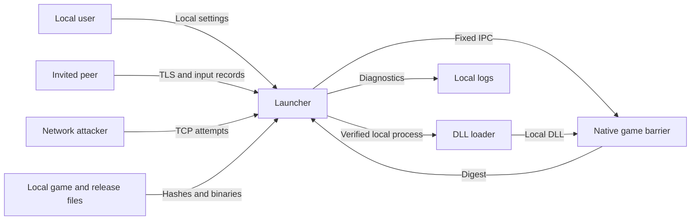

# TH12 CO-OP threat model

評価日: 2026-10-29。対象: TH12 CO-OP。実装の詳しい制限・接続方式は[通信設計](network-security-design.md)、最終試験の記録は[検証結果](../verification/RESULTS.md)を参照する。

2026-10-30追記: 以下の評価時点はRules 3 / Protocol 3。現在の実装はRules 4 / Protocol 4 (`T12L4`)で、認証後の機体選択、マニフェストによる双方の選択確定、PC固有設定と共通設定の分離を追加した。新しい境界・形式は[現行通信設計](network-security-design.md)と[PC別設定](local-configuration.md)を参照。旧番号の記述を現行の接続仕様と扱わない。

## Executive summary

非公開招待の2人協力プレイを対象に、接続相手から任意のコード・パス・プロセスを指定させない境界を確認した。通信はTLS 1.3、証明書pin、256-bit参加鍵、固定レコードと入力範囲の検証で保護する。通信版は3、協力ルール版は3、ローカルIPC構造体版は1、招待形式はT12L3。通常版1.00a・通常版1.00b・Steam版1.00bを既知hashで識別し、1.00b同士の通常版/Steam版の混在は既知プロファイルと資産の検証後に許可する。オフラインもオンラインも停止状態から起動し、パッチ設置の失敗時はゲーム進行を再開せず所有プロセスを終了する。残る主なリスクは、公開した待受ポートへの可用性攻撃、招待の漏洩、未署名のローカル配布物への信頼、および部分的な状態digestによる同期不良の検出限界。確定した試験結果と未検証範囲は検証結果を正とし、全状態・全ステージの一致を保証しない。

## Scope and assumptions

- ユーザー確認済み: 非公開招待の2人利用。各PCが自分の正規TH12を実行し、入力を同期する。外部サービスは現時点で不要、デプロイしていない。
- Runtime範囲: src/launcher、src/native、src/injector。Windows 11、既知の通常版1.00a・通常版1.00b・Steam版1.00b、ユーザー権限のプロセスを前提とする。1.00aと1.00bのオンライン混在は拒否する。Steam版は利用者の正常なSteam起動と所有確認を前提とする。根拠: TH12Coop.Launcher.csproj、GameBuild.Supported、OnlineProfile.ValidateAssets、injector.cpp/isKnownGame。
- 開発・配布範囲: build.ps1、scripts/Prepare-Game.ps1、scripts/Package.ps1。スモークDLLと同一PC複数ゲームのテスト分岐は開発経路であり、通信から選択させない。
- 範囲外: 公開マッチング、外部中継の本番運用、競技用アンチチート、OS侵害・同一ユーザーのマルウェアからの完全な隔離。ゲーム原作のソースコードは提供されておらず、解析済みEXEへの接続を評価する。
- リスクを変える未確定事項: 将来待受を常時インターネット公開するか、公開リリースの署名・配布主体をどうするか。外部公開を行う場合は再評価する。

## System model

### Primary components

- C# WinFormsランチャー/.NET 10: UI、招待、TLS、入力フレーム管理。根拠: LauncherForm.StartSession、OnlineSession、LockstepPeer。
- C++ x86ローダーとnative DLL: ローカルの対応EXEへ注入し、原作の入力境界で進行を待機する。根拠: injector.cpp、th12coop.cpp/pollHook、lockstep.h/Poll。
- ローカルゲーム・セッション領域: 既知EXE、対応DAT/BGM、設定、ローカル許可リストの依存DLL、ローカル診断ログ。Steam用作業領域のApp IDは固定値1100160。根拠: GameBuild.Assets/PrepareSteamIdentity、OnlineProfile.Read/Prepare、LockstepPeer.Compare。
- ビルド/配布: MSVC x86と.NET10 SDKの自己完結配布。クラウド実行・アカウントサービス・DBは使用しない。根拠: build.ps1、TH12Coop.Launcher.csproj。

### Data flows and trust boundaries

- 利用者 → ランチャー: ローカルUI/CLIでゲーム位置、ホストIP、ポート、招待を指定。通信相手はこれらのローカル引数を書き換えられない。根拠: LauncherForm.StartSession、Program.Main。
- ネットワーク/相手PC → SecureChannel: TCP/TLS1.3。招待の証明書SHA-256 pinと参加鍵を検証。認証8件/4秒、アプリ本文4KiB上限。根拠: Protocol.cs/Connect/Accept/Receive、OnlineSession.AcceptGuest。
- 認証済みpeer → LockstepPeer → native IPC: role、session、連続frame、許可bitを検証し、120件窓、頻度上限を適用。OnlineProfile.ValidateRulesとnative lockstep.Initializeはルール版3以外を拒否し、MOD DLL hashも一致を要求する。固定サイズmappingへ要求中の1フレームだけをcommitする。根拠: OnlineProfile、NetBridge.Commit、lockstep.h/Initialize/Poll。
- ローカル配布物/ゲーム → ローダー/ゲームプロセス: EXEの既知SHA-256、PE layout、フック命令を照合。DLLはローカル絶対パス。相手のbuild IDとEXE/DAT/BGMの組合せも既知リストへ照合してから互換性を判定し、1.00bの通常版/Steam版間でもDAT/BGM/native/config/依存関係digestの一致を要求する。peer間ハッシュ一致は配布元の真正性とは別。根拠: GameBuild、OnlineProfile.Read/ValidateAssets、GameSession.StartCore、injector.cpp/isKnownGame、game_layout.h/SelectLayout、th12coop.cpp/installHooks。
- ローカル起動 → 停止中のゲーム: 全モードでCREATE_SUSPENDEDを使い、注入前にKILL_ON_JOB_CLOSEを持つ無名Jobへ所有ゲームだけを登録する。SILENT_BREAKAWAY_OKでSteam補助プロセス等の自動所属を避け、登録失敗なら再開しない。16バイトのBoot mappingにmagic、版1、CreateProcess由来thread ID、early flagを渡す。coop_bootは値とthreadのプロセス所属を確認する。通常版は既知entryで停止した状態で設置する。ネットワーク診断だけは既存Net IPC offset92からのearly起動互換経路も持つ。起動metadataは同権限プロセスへの秘密・認証境界ではない。根拠: OwnedGameJob.AssignSuspended、GameSession.StartCore、coop_boot.h、injector.cpp/initializeLoader。
- 正常なSteam startup → native game hook: status5で一時的なclock import待受を公開し、既知seed戻り先とcoop_bootが確認したprimary thread IDが一致した場合だけ設置へ進む。元のimportを復元し、全game hookの命令照合後にready/device-readyへ進む。相手はseedの数値以外のコード位置やthreadを指定できない。設置途中の保護変更失敗では命令の復元を試みるが、OS失敗時の完全な巻戻しは保証せず、停止を維持してランチャーが所有ゲームを終了する。根拠: th12coop.cpp/armSteamBootstrap/bootstrapClock/installHooks/bootstrapFailed、patch.h、GameSession.StartCore。
- ゲーム → ローカルログ: 数値digestの不一致とnative診断を保存。相手から指定された出力パスやログ本文は受け付けない。根拠: LockstepPeer.Compare、th12coop.cpp/crashTrace。

#### Diagram

## Assets and security objectives

| Asset | Why it matters | Security objective (C/I/A) |
|---|---|---|
| 参加鍵と証明書秘密鍵 | 招待されていない第三者の入室を防ぐ | C/I |
| 利用者のPC・ファイル | 相手の入力を任意コード/パス実行へ変換しない | C/I |
| 原本のゲーム・設定・スコア | MOD用作業領域と分離し、失敗時も原本を保全 | I/A |
| 両PCのゲーム状態 | 同じフレームの入力を適用し、不一致時に停止 | I/A |
| 接続・メモリ・CPU・ディスク | 相手のレコードや接続数で無制限に消費しない | A |
| 配布物と診断結果 | 対応バイナリを使用し、検証範囲を過大表示しない | I |

## Attacker model

### Capabilities

第三者は到達可能な待受へのTCP接続、通信の遅延・遮断・改ざんを試せる。招待を知る者は正規TLS接続を作り、任意のアプリレコード、入力、虚偽のdigestを送れる。配布経路が侵害された場合は、利用者が取得するローカルDLL/EXEを差し替えられる。根拠: OnlineSession.AcceptGuest、SecureChannel、LockstepPeer.AcceptRecord、GameSession.StartCore。

### Non-capabilities

ネットワーク相手には任意のDLL、URL、PID、アドレス、ファイルパスを実行させるメッセージがない。証明書pinとTLSを破らずに参加鍵を読み取れるとは仮定しない。同一ユーザーのローカルマルウェアはすでにゲームの権限を持ち得るため、IPC名だけを秘密にして完全防御できるとは評価しない。

## Entry points and attack surfaces

| Surface | How reached | Trust boundary | Notes | Evidence (repo path / symbol) |
|---|---|---|---|---|
| TCP待受・TLS | 指定ポート、標準3012 | ネットワーク→ランチャー | 一度に8認証、4秒期限 | src/launcher/OnlineSession.cs/AcceptGuest |
| 招待・認証hello | ローカル貼付け/TLS内 | 利用者/peer→認証 | cert pin、256-bit鍵、版と役割 | src/launcher/Protocol.cs/RoomIdentity/ValidateHello |
| manifestとレコード | 認証済みTLS | peer→同期処理 | 4KiB、型・frame・bit・頻度検証 | OnlineProfile.Validate、LockstepPeer.AcceptRecord |
| 共有メモリ・起動metadata | 同一Windowsセッション | ランチャー→C++ | Boot16、固定サイズNet IPC、CreateNew、rules3、sequence、abort。同権限の隔離ではない | GameSession.StartCore、coop_boot.h、NetBridge.cs、lockstep.h |
| EXE/DLL/設定 | ローカルファイル/配布ZIP | 配布物→ユーザープロセス | EXE既知版、命令照合。独立した配布署名なし | GameSession.StartCore、src/injector/injector.cpp |
| Steam起動待受 | 既知Steam本体の正常なstartup | ローカルローダー→game hook | status 5、seed戻り先＋primary thread照合、import復元後に設置。認証迂回なし | th12coop.cpp/bootstrapClock、game_layout.h/SelectLayout |
| 診断・セッション領域 | 自動生成 | ゲーム→ローカルディスク | 固定ファイル名、binary sessionのhex化 | OnlineProfile.Prepare、LockstepPeer.Compare |

## Top abuse paths

1. **第三者が席を奪う** → 漏れた招待を取得 → 正しい参加鍵で先に接続 → 意図した相手が入れない。招待はbearer権限であり、入手者の実名確認はしない。
2. **待受を妨害する** → 認証前ソケット8件を占有し繰返す → 各接続の4秒上限内でも正規接続を圧迫 → セッションを開始できない。
3. **参加者が処理を圧迫する** → 正規認証後にping/未来frame/過大本文を送る → 上限違反で切断されゲーム停止。無制限メモリ確保は防ぐが、悪意ある協力相手から可用性を保証できない。
4. **同期不良を隠す** → 改造peerが既知buildの識別値や偽digestを返す、または未収録の状態だけがずれる → サマリー一致を悪用/誤解 → 遅れて不一致が表面化。既知hashの申告は相手PCの実行状態を遠隔証明するものではなく、完全状態の証明やアンチチートではない。未収録fieldの存在だけを、確認済みの実ゲーム不具合とは扱わない。
5. **配布物からコードを実行する** → 信頼していないZIPやローカルDLLを利用者へ渡す → ランチャーがそのローカルMODをロード → 利用者権限でのコード実行。peerの入力レコードから直接到達する経路ではない。
6. **ローカル領域を妨害する** → 同一ユーザーの別プロセスがIPC名やセッション領域を先取り/改変 → 起動失敗やローカルデータへの干渉 → 同権限マルウェアへの分離限界が表面化。

## Threat model table

| Threat ID | Threat source | Prerequisites | Threat action | Impact | Impacted assets | Existing controls (evidence) | Gaps | Recommended mitigations | Detection ideas | Likelihood | Impact severity | Priority |
|---|---|---|---|---|---|---|---|---|---|---|---|---|
| TM-001 | 非招待者/漏洩先 | 到達性と招待の漏洩が必要 | 招待を再利用し正規相手より先に参加 | 不正入室・セッション妨害 | 参加鍵、ゲーム状態 | TLS pin+cap固定時間検証、ホスト終了後のidentity更新 (Protocol.cs、LauncherForm.StartSession) | 招待所有者を実名確認しない。クリップボード等のコピーは残り得る | private共有を維持し、終了済み招待拒否を回帰試験 | 鍵を含めず認証成功/失敗を確認 | low: 256-bit推測は現実的でなく漏洩が前提 | medium: 参加/停止は可能だがファイル実行権限はない | low |
| TM-002 | 到達可能な第三者 | 待受ポートが公開/到達可能 | 認証枠と回線を継続占有 | ゲーム開始不能 | 可用性 | 同時8件、4秒期限、待機1件 (OnlineSession.AcceptGuest) | IP別制限なし。回線DDoSは対象外 | 既知peer向けVPN/ファイアウォールを優先。常時公開する場合は接続頻度制限を追加 | 認証枠占有/拒否の集計、秘密を記録しない | medium: 公開時は容易、private LANでは低い | medium: 待受と利用者回線が影響 | medium |
| TM-003 | 認証済み改造peer | 招待が必要 | 過大/高頻度/順序違い/停止したレコードを送る | セッション停止、処理量増加 | メモリ、CPU、ゲーム可用性 | 4KiB確保前検証、512/s、ping4/s、120件窓、35秒入力待ち (SecureChannel.Receive、LockstepPeer.AcceptRecord/Pump) | 協力相手自身による切断は防げない | idle認証、途中本文、読まないpeer、終了時cleanupを実通信で回帰試験 | bounded timeoutと違反理由。招待/本文はログ不要 | medium: 参加者なら容易だがtrusted friend前提 | medium: boundedな停止、任意コード実行の証拠なし | medium |
| TM-004 | 改造peer/未検証状態の不具合 | ゲーム実行または偽digest送信 | 未収録状態の差や虚偽hashを見逃させる | 異なるゲーム進行・検証の誤認 | 状態整合性、診断結果 | 毎frameの部分FNV64比較、版/asset照合、不一致停止 (lockstep.h/Fingerprint、LockstepPeer.Compare) | ECL raw stack、弾/レーザー/ホーミング等に未収録状態あり。全ステージの網羅試験は未完了 | 不一致の根本原因を再現試験で検証。採用fieldを明記し全状態保証をしない | 最初の不一致frameとcomponent、原本を含めない診断 | medium: 未採用状態と未検証場面に不確実性が残る | medium: ゲーム正しさに影響、peerから任意メモリ復元はしない | medium |
| TM-005 | 悪意ある配布元/ローカル差替え | 利用者が信頼できないMODを取得/実行 | DLL/ランチャーを差し替える | 利用者権限のコード実行 | PC、ファイル、配布物 | 既知ゲームEXEと命令照合、peer由来pathを禁止 (injector.cpp、th12coop.cpp/start、OnlineProfile) | 相互hashは配布署名ではない | 公開配布時は信頼した経路と独立した署名/指紋を提供。ローカルbuildとの差を検証 | 配布hash、署名検証、再現可能なbuild記録 | low: 現在ローカル作成、第三者配布なし | high: 実行すればユーザー権限で動く | medium |
| TM-006 | 同一ユーザーのローカルプロセス | 同一権限で先取り/改変可能 | 固定IPC名や作業ファイルへ干渉 | 起動停止、ローカル整合性喪失 | IPC、設定、ゲーム | net mapping CreateNew、固定サイズ/版、EXEhash、原本から分離 (NetBridge、Prepare-Game.ps1) | PID名events、ハードリンクは同権限隔離ではない | 外部からstate/pathを受けない現境界を維持。多ユーザー運用を追加する場合のみACL/ランダム起動tokenを設計 | 名前衝突・版不一致でfail closed、起動前後の原本hash | low: リモートから直接条件を作れず、同権限侵害は範囲外 | medium: MODだけで隔離不能 | low |

## Criticality calibration

- **critical**: 招待なしのネットワークレコードから任意コード実行、または任意のローカルファイル書換えへ直結する場合。今回その経路は確認していない。
- **high**: 認証を回避して招待鍵を取得する場合、または通常の入力がローダーの任意DLL/PID指定に変わる場合。配布物改変の影響は高いが、現在のprivateローカル配布という前提でTM-005の優先度はmedium。
- **medium**: 認証枠/受信処理を圧迫して開始不能にする場合、または同期不良を検出できずゲームの正しさを失う場合。可用性と実ゲームの信頼性を優先する。
- **low**: ローカル同権限を必要とするIPC先取り、または低感度の接続時刻/相手IPの露出。公開サービス・多ユーザー運用へ変わる場合は格上げを再検討する。

## Focus paths for security review

| Path | Why it matters | Related Threat IDs |
|---|---|---|
| src/launcher/Protocol.cs | pin/参加鍵/期限/本文確保上限と鍵寿命 | TM-001, TM-003 |
| src/launcher/OnlineSession.cs | 認証前接続の所有・上限・キャンセル | TM-002, TM-003 |
| src/launcher/LockstepPeer.cs | frame/role/session検証、bounded状態、起動終了Task所有 | TM-003, TM-004 |
| src/launcher/NetBridge.cs | 単一commit、mapping寿命、abort、ローカル境界 | TM-003, TM-006 |
| src/launcher/OnlineProfile.cs、GameBuild.cs | build IDと既知EXE/assetの結合、互換群と依存関係の検証、相手のhashとローカルpathの分離 | TM-004, TM-005, TM-006 |
| src/launcher/LauncherForm.cs | 部屋終了後の招待更新、UI再開前のcleanup | TM-001, TM-003 |
| src/launcher/GameSession.cs、OwnedGameJob.cs | 停止中に所有ゲームだけをJobへ登録、注入/終了、起動失敗の復元 | TM-003, TM-005, TM-006 |
| src/native/lockstep.h、coop_resources.h、coop_effects.h | rules3、共有メモリ境界、非同期loadの待機、復帰権・所有者・世代と部分digest | TM-004, TM-006 |
| src/native/coop_boot.h、patch.h | 全モードのearly起動契約、thread所属、命令照合、設置失敗と復元試行 | TM-004, TM-005, TM-006 |
| src/native/th12coop.cpp、game_layout.h | 既知layoutと対応命令、Steam起動待受のthread/戻り先検証、import復元とready順序、オブジェクト寿命 | TM-004, TM-005 |
| src/injector/injector.cpp | PID/EXE/ロードパスのローカル検証 | TM-005 |
| scripts/Prepare-Game.ps1 | 原本保全、既知asset照合、作業先の範囲 | TM-005, TM-006 |
| build.ps1 | .NET10 runtime、native/managed成果物の分離 | TM-005 |

## Notes on use

- 確認済み: 招待、TCP/TLS、manifest、入力、mapping、ローダー、ローカルファイル/ログの入口をモデル化した。各境界に対応する脅威を含めた。
- runtimeと開発/スモーク経路を区別し、ユーザー確認済みの2人private招待を優先度へ反映した。新しい外部デプロイの許可とは解釈していない。
- 任意のbuild名を互換と扱わず、既知プロファイルの検証後にのみ通常版1.00b/Steam版1.00bを同一群へ入れる。システム依存DLLが両方で`system`の場合、その識別値はシステムDLL全体のhash一致を意味しない。
- ルール版3のdigestには共有復帰権・全滅状態・ボム所有者、damage source・ボム・スペル・ランク、アイテム・標的・衝突の保持状態、霊夢Aの現世代emitter/beamの所有者と確認済み座標・タイマーを含む。ポインタはactor IDや判定番号へ正規化し、無関係な演出や旧世代payloadは比較しない。ルール3でRA beam移動履歴の確認済み`+2A0..+363`、primary/async ECL命令位置と初期化済みscalar、UFO/報酬/ベントラー、弾Ex状態を追加した。raw ECL stackや一部の弾・レーザー・ホーミング状態は未収録で、完全snapshotは未実装。現在のdamage geometryの一致だけで将来の全挙動の一致を証明しない。
- 通常の起動失敗・切断・中止では所有ゲームの終了を待って回収する。ランチャー異常終了時にも所有handleの閉鎖でゲームを終了させるJob Objectを実装し、Steam補助プロセス等の子プロセスはこのJobの対象に含めない。`--owner-exit-test`の起動記録と、外部runnerによるゲーム終了確認は別の証拠として扱う。ここでは実行試験の合格を宣言せず、検証結果へ集約する。
- 脆弱性が存在するという確定報告と、攻撃経路の検討を区別した。上限やTLSの存在だけで安全性の証明とはしない。
- 試験ごとの合否は検証結果へ集約する。同一PCのペア試験を、別PC/別拠点や全機体・全ステージの検証へ拡張解釈しない。公開配布の信頼確認と外部中継の運用評価は別途必要。
